# EveryInfra Research — Multi-source fact checking with explicit evidence gaps

<p align="center">
  <picture>
    <source media="(prefers-color-scheme: dark)" srcset="assets/hero-dark.svg">
    <source media="(prefers-color-scheme: light)" srcset="assets/hero-light.svg">
    
  </picture>
</p>

<p align="center">
  <a href="https://cursor.com/en/install-mcp?name=everyinfra&config=eyJ1cmwiOiJodHRwczovL2FwaS5ldmVyeWluZnJhLmNvbS9tY3AiLCJoZWFkZXJzIjp7IkF1dGhvcml6YXRpb24iOiJCZWFyZXIgPEFQSSBLZXk%2BIn19"></a>
  <a href="https://vscode.dev/redirect/mcp/install?name=everyinfra&config=%7B%22type%22%3A%22http%22%2C%22url%22%3A%22https%3A%2F%2Fapi.everyinfra.com%2Fmcp%22%2C%22headers%22%3A%7B%22Authorization%22%3A%22Bearer%20%3CAPI%20Key%3E%22%7D%7D"></a>
  <a href="https://github.com/everyinfra/everyinfra-agent-plugins#claude-code"></a>
  <a href="https://github.com/everyinfra/everyinfra-agent-plugins#codex"></a>
</p>

<p align="center">
  <a href="https://github.com/everyinfra/everyinfra-agent-plugins/stargazers"></a>
  &nbsp;<b>Star the main repo and get $1 in credit.</b> <a href="https://everyinfra.com/en/docs?utm_source=github&utm_medium=readme&utm_campaign=everyinfra-research-plugin&utm_content=star_line#quickstart">How to claim →</a>
</p>

<p align="center"><b>English</b> · <a href="README.zh-CN.md">简体中文</a> · <a href="README.es.md">Español</a></p>

> [!TIP]
> **This repository holds one skill: EveryInfra Research.** The complete EveryInfra plugin (10 skills, the remote MCP server at `https://api.everyinfra.com/mcp`, and setup for Claude Code, Codex, Cursor and VS Code) lives in **[everyinfra/everyinfra-agent-plugins](https://github.com/everyinfra/everyinfra-agent-plugins)**. The buttons above connect the MCP server; the per-host plugin installs are in the main repo.

[Setup](docs/setup.md) · [Workflow](docs/workflow.md) · [Prompts](examples/prompts.md) · [Capability reference](docs/reference.md) · [API documentation](https://api.everyinfra.com/docs)

EveryInfra Research is a standalone agent skill for multi-source fact checking using EverySearch MCP. It scopes a current claim, compares original sources and dates, and produces a cited conclusion with contradictions and evidence gaps made explicit.

A credible research answer needs more than several links. EveryInfra Research frames one concrete claim, keeps dates and jurisdiction attached, compares original sources and separates agreement from contradictions or missing evidence before writing the conclusion.

Use it when the deliverable is a defensible answer to a current question, not merely a search-result list. This standalone skill calls EverySearch directly; a separate EverySearch plugin is not required.

## What you can do

- Check whether a product or policy claim is true for a specified date and version.
- Compare primary sources that disagree and explain the unresolved boundary.
- Produce a source-linked answer with a confidence level justified by the retrieved evidence.

## Quick start

This is a standalone, one-skill **MCP workflow** package, not a new API service. It requires a compatible agent host and the configured access described in [setup](docs/setup.md). Local package validation does not establish live API availability.

Install the source repository in Codex after reviewing its contents. These commands add a GitHub-backed repository catalog, not an official marketplace endorsement:

```bash
codex plugin marketplace add everyinfra/everyinfra-research-plugin
codex plugin add everyinfra-research@everyinfra-research-plugin
```

For a local checkout, replace the first command's source with `.`. [Setup](docs/setup.md) also covers Claude Code and the separate service connection.

Configure access once, then ask:

> Verify this current product claim as of the date I provide. Prefer original documentation and separate confirmed facts from gaps.

This initial prompt is scoped to inspection or preparation. Review any paid operation or external side effect before proceeding. Claude Code instructions and Cursor packaging boundaries are in [setup](docs/setup.md).

## How the workflow works

1. Write the concrete claim or decision question, preserving date, jurisdiction, version and site scope.
2. Discover everyinfra_search and the live crosscheck schema.
3. Keep retrieval mechanisms distinct. Do not count duplicated keyword searches as independent corroboration.
4. Inspect original URLs and source dates; distinguish publication date from event date when relevant.
5. Report agreement, contradictions and gaps, then state a conclusion no stronger than the evidence allows.

### What a useful result contains

A concise claim, scoped conclusion, supporting original links, relevant dates and an explicit uncertainty section. The workflow should make it possible for a reader to inspect why the conclusion follows.

## When to use this skill

EverySearch retrieves material. Research adds claim definition, source comparison and evidence-calibrated conclusions. It does not replace professional judgment in high-stakes decisions.

## Limits and safety

- An unavailable or empty retrieval path is uncertainty, not proof that a claim is false.
- Independent mechanisms do not automatically mean independent publishers or underlying evidence.
- No guarantee that every current claim can be resolved, and no invented confidence percentage.

The package contains one skill and does not grant permissions or register a duplicate MCP connection. Never put credentials in prompts, checked-in files, screenshots or shared logs. Discovery, API execution, billing and a final external result are separate states. See [security](SECURITY.md).

## Frequently asked questions

### Why is this separate from search?

The output is different: a judged, cited conclusion with contradictions and gaps, rather than retrieved pages alone.

### Do three links count as three independent sources?

Not necessarily. Several pages may repeat one announcement. Inspect the original evidence and distinguish retrieval diversity from source independence.

### What if crosscheck is unavailable?

Disclose the limitation. A narrower available search may still help, but it must not be presented as an equivalent cross-check.

## Validate and contribute

```bash
python3 scripts/validate.py
```

This offline check validates packaging, local documentation links, the single-skill boundary, metadata and fixtures. It does not send messages, allocate resources or verify a production account. [Contribution guidance](CONTRIBUTING.md) and [the release checklist](RELEASING.md) describe the remaining checks.

Source publication, tagged releases, official marketplace acceptance and live service verification are separate milestones. Maintained by [EveryInfra](https://everyinfra.com). Licensed under [Apache-2.0](LICENSE).
